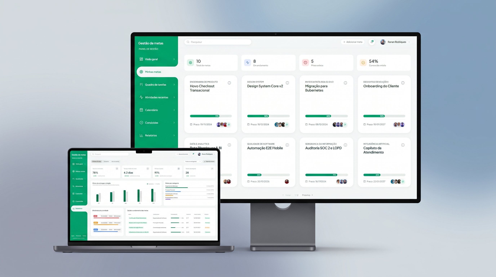

<div align="center">

# Goal Management Frontend

<p align="center">
  Plataforma web integrada para planejamento estratégico, acompanhamento ágil de metas e colaboração em tempo real com painéis visuais e quadros Kanban.
</p>

[](https://react.dev/)
[](https://www.typescriptlang.org/)
[](https://vitejs.dev/)
[](https://styled-components.com/)
[](https://tanstack.com/query)
[](https://opensource.org/licenses/MIT)

<br />
<br />



<br />
<br />

<a href="https://github.com/devrnrodrigues/goal-management-backend">
  
</a>

</div>

---

## Tecnologias

| Tecnologia | Finalidade |
| --- | --- |
| **React 19** | Biblioteca declarativa baseada em componentes para construção da interface de usuário |
| **TypeScript** | Superset com tipagem estática rigorosa para prevenção de falhas em tempo de compilação |
| **Vite** | Ferramenta de empacotamento ultrarrápida e servidor de desenvolvimento otimizado |
| **Styled Components** | Estilização orientada a componentes (CSS-in-JS) com design tokens e temas centralizados |
| **TanStack Query v5** | Gerenciamento de estado de servidor, cache inteligente, revalidação e mutações assíncronas |
| **Framer Motion** | Criação de animações fluidas, transições de estado e micro-interações de tela |
| **Lucide React** | Conjunto abrangente de ícones vetoriais padronizados e acessíveis |
| **Date-fns** | Manipulação, cálculo de intervalos e formatação de datas em padrão brasileiro |
| **React Datepicker** | Componente de seleção interativa de datas de prazos e filtros cronológicos |
| **Oxlint** | Linter estático de alta velocidade focado na consistência e qualidade do código |

---

## O que é esse projeto?

O **Goal Management Frontend** é uma aplicação web desenvolvida para transformar a forma como indivíduos e equipes gerenciam seus objetivos pessoais e profissionais. O app centraliza o planejamento estratégico em um ecossistema intuitivo e dinâmico, permitindo desmembrar grandes metas em tarefas operacionais organizadas em quadros Kanban, acompanhar o ritmo de entregas com métricas de progresso em tempo real, gerenciar prazos em calendários dedicados e viabilizar a colaboração entre múltiplos membros com papéis de acesso bem definidos.

---

## Motivação

A aplicação foi projetada para solucionar a fricção comum entre o planejamento de metas a longo prazo e a execução diária de tarefas, unificando visão macro estratégica e controle micro operacional em uma única interface. Do ponto de vista de engenharia, a decisão técnica centrou-se em construir um frontend performático e desacoplado através da arquitetura orientada a funcionalidades (*Package by Feature*), isolando o estado do servidor com TanStack Query para eliminar chamadas desnecessárias à rede, garantindo resiliência de autenticação com renovação atômica de tokens (*anti-race condition*), eliminando estilos inline com tokens padronizados de Styled Components e assegurando confiabilidade estrutural por meio de tipagem estrita com TypeScript.

---

## Funcionalidades

### Autenticação & Sessão (`auth`)
- Login e cadastro tradicional com credenciais de e-mail e senha.
- Login social integrado via Google Identity Services (OAuth 2.0).
- Renovação automática e transparente de sessão via Refresh Token.
- Encerramento seguro de sessão e redirecionamento de acessos expirados.

### Painel Consolidado (`dashboard`)
- Indicadores em tempo real de metas ativas, metas concluídas e taxa global de conclusão.
- Distribuição quantitativa de metas por categoria e criticidade de prazos.
- Skeletons animados com efeito shimmer durante o carregamento de dados.

### Gestão de Metas (`my-goals`)
- Cadastro, edição, detalhamento e exclusão de metas.
- Configuração de prazos com validação de data inicial e término.
- Gestão colaborativa de membros vinculados com permissões (`OWNER`, `ADMIN`, `VIEWER`).
- Filtros por status, categoria e busca textual instantânea.

### Quadro de Tarefas (`task-board`)
- Visualização Kanban das tarefas vinculadas a cada objetivo.
- Criação, edição, exclusão e reordenação de colunas dinâmicas.
- Criação e movimentação de tarefas entre colunas com recálculo automático de progresso.

### Metas Concluídas (`completed-goals`)
- Histórico de objetivos arquivados e finalizados com cálculo de dias de duração e taxa de entrega.

### Calendário & Prazos (`calendar`)
- Mapeamento das datas limites em grade temporal para acompanhamento de prazos.

### Atividades Recentes (`recent-activity`)
- Linha do tempo com auditoria cronológica das ações realizadas por membros e usuários.

### Relatórios (`reports`)
- Visualização de desempenho e estatísticas consolidadas de produtividade.

### Perfil do Usuário (`profile`)
- Consulta e edição das informações de perfil (nome, e-mail e preferências de conta).

---

## Interface (UI/UX)

- **Design System com Tokens Globais**: Paleta de cores, espaçamentos, tipografia e bordas centralizados no tema global (`theme.ts`), garantindo consistência visual e manutenibilidade.
- **Skeletons com Shimmer Effect**: Componentes visuais dedicados (`DashboardSkeleton`, `GoalsSkeleton`) que evitam saltos de layout (*layout shifts*) e fornecem feedback imediato durante requisições.
- **Transições e Micro-interações**: Animações suaves de abertura de modais, transições de abas e expansão de menus laterais implementadas com `framer-motion`.
- **Feedbacks Visuais e Notificações**: Sistema global de toasts (`ToastProvider`) para alertar o usuário de forma não intrusiva sobre operações bem-sucedidas ou falhas de comunicação.

---

## Segurança

- **Armazenamento de Tokens JWT**: O token de acesso é mantido no cliente e anexado automaticamente no cabeçalho `Authorization: Bearer <token>` em todas as chamadas privadas.
- **Renovação com Fila Única (Anti-Race Condition)**: Algoritmo centralizado no `httpClient` que intercepta requisições concorrentes quando o token expira (401), compartilhando uma única promessa de renovação de refresh token (`refreshSessionOnce`) para evitar falhas em cascata.
- **Autenticação OAuth 2.0**: Integração segura com Google Identity Services utilizando escopos restritos (`openid`, `email`, `profile`) sem exposição de segredos de cliente no navegador.
- **Proteção de Rotas & Sessão Ativa**: Renderização condicionada ao estado de autenticação; na impossibilidade de renovação, o evento global `auth-session-expired` é acionado para encerrar a sessão e redirecionar ao login.
- **Isolamento de Variáveis no Cliente**: Apenas variáveis explicitamente expostas com o prefixo `VITE_` são empacotadas no build do cliente.

---

## Validações

- **Validação de Formulários**: Verificação síncrona de campos obrigatórios, regras de tamanho de senha e formato de e-mail antes do envio à API.
- **Integridade Temporal**: Validação lógica bloqueando prazos inconsistentes (data limite anterior à data de início da meta).
- **Validação de Mídia e Imagens**: Validação de URLs e avatares no cadastro de perfil e membros.
- **Tratamento de Validações do Backend**: Mapeamento dos erros de validação retornados pelo servidor (`errors: Record<string, string>`) diretamente nos campos do formulário.
- **Tipagem Estrita**: Interfaces e tipos TypeScript explícitos impedindo passagem de dados incompatíveis em tempo de desenvolvimento.

---

## Tratamento de Erros

- **Cliente HTTP Centralizado (`httpClient`)**: Normalização de todas as falhas de rede e respostas HTTP não-2xx para o contrato `ApiError`:
  ```typescript
  interface ApiError {
    status: number;
    message: string;
    errors?: Record<string, string>;
  }
  ```
- **Interceptação de Erro 401**: Tentativa de renovação transparente via refresh token antes de propagar o erro ao usuário.
- **Componentes de Fallback & Empty States**: Telas amigáveis de módulo em desenvolvimento (`PlaceholderPage`), cards de lista vazia e ilustrações contextuais quando não há dados cadastrados.
- **Modo Mock Desacoplado**: Chave de desenvolvimento offline (`isMockSession`) permitindo navegar e testar a interface mesmo sem o backend em execução.

---

## Arquitetura

O frontend é estruturado segundo a arquitetura orientada a funcionalidades (**Package by Feature**), na qual cada domínio de negócio contém seus próprios componentes, rotas, hooks, estilos e tipos.

### Estrutura de Pastas

```text
src/
├── assets/                     # Recursos visuais estáticos (imagens, logotipos)
├── features/                   # Módulos de domínio da aplicação
│   ├── auth/                   # Autenticação local e Google OAuth 2.0
│   │   ├── api/                # authApi (login, register, google, refresh, logout)
│   │   ├── components/         # Formulários de autenticação e painéis
│   │   ├── hooks/              # useAuth e controle de fluxo
│   │   ├── styles/             # Estilos dedicados de autenticação
│   │   └── types/              # Contratos e tipos de credenciais
│   ├── calendar/               # Calendário temporal de entregas
│   ├── completed-goals/        # Histórico de metas concluídas
│   ├── dashboard/              # Painel consolidado com métricas
│   ├── layout/                 # Sidebar, Header e casca de navegação
│   ├── my-goals/               # CRUD de metas e membros
│   ├── notes/                  # Caderno de anotações rápidas
│   ├── notifications/          # Central de avisos do sistema
│   ├── profile/                # Perfil e configurações de conta
│   ├── recent-activity/        # Linha do tempo e histórico de ações
│   ├── reports/                # Relatórios e indicadores
│   ├── settings/               # Preferências da aplicação
│   ├── shared/                 # Componentes e serviços transversais
│   │   ├── api/                # httpClient, usersApi e sessão
│   │   ├── components/         # Modais, skeletons, botões e cards base
│   │   ├── context/            # ToastProvider e gerenciamento de toasts
│   │   ├── styles/             # Tema global, tokens e estilos base
│   │   └── types/              # Tipagens compartilhadas
│   └── task-board/             # Quadro Kanban interativo de tarefas
├── App.css                     # Estilos utilitários de apoio
├── App.tsx                     # Orquestrador de rotas, sessão e layout
├── index.html                  # Ponto de entrada HTML
└── main.tsx                    # Inicialização do React DOM
```

### Rotas de Navegação

| Navegador / Aba | Rota / ID | Componente | Descrição |
| --- | --- | --- | --- |
| **Autenticação** | `/auth` | `<AuthPage />` | Formulário de acesso, registro e login social |
| **Dashboard** | `dashboard` | `<DashboardPage />` | Visão consolidada de indicadores e taxas de sucesso |
| **Minhas Metas** | `goals` | `<MyGoals />` | Gerenciamento completo de metas ativas e membros |
| **Quadro de Tarefas** | `task-board` | `<TaskBoard />` | Visualização Kanban de tarefas por colunas e status |
| **Metas Concluídas** | `completed-goals` | `<CompletedGoalsPage />` | Histórico e métricas de objetivos finalizados |
| **Calendário** | `calendar` | `<CalendarPage />` | Grade cronológica de prazos de entrega |
| **Atividades Recentes** | `recent-activity` | `<RecentActivity />` | Linha do tempo de auditoria de alterações |
| **Relatórios** | `reports` | `<ReportsPage />` | Gráficos e estatísticas de rendimento |
| **Perfil** | `profile` | `<PlaceholderPage />` | Dados do usuário e configurações de conta |
| **Anotações** | `notes` | `<PlaceholderPage />` | Bloco de anotações rápidas vinculadas |
| **Notificações** | `notifications` | `<PlaceholderPage />` | Central de avisos e lembretes |
| **Configurações** | `settings` | `<PlaceholderPage />` | Preferências de layout e interface |

### Integração com APIs

A comunicação ocorre através do `httpClient` centralizado consumindo os endpoints REST do backend sob o prefixo `/api`:

<details>
<summary><strong>Expandir Tabela de Endpoints Consumidos</strong></summary>

<br />

| Domínio | Método | Endpoint | Acesso | Descrição |
| --- | --- | --- | --- | --- |
| **Auth** | `POST` | `/auth/login` | Público | Autenticação com e-mail e senha |
| **Auth** | `POST` | `/auth/register` | Público | Cadastro de novo usuário |
| **Auth** | `POST` | `/auth/google` | Público | Autenticação social via Google OAuth |
| **Auth** | `POST` | `/auth/refresh` | Público | Renovação de access token |
| **Auth** | `POST` | `/auth/logout` | Autenticado | Encerramento de sessão ativa |
| **Metas** | `GET` | `/goals` | Autenticado | Listagem paginada de metas |
| **Metas** | `POST` | `/goals` | Autenticado | Criação de nova meta |
| **Metas** | `GET` | `/goals/{id}` | Autenticado | Consulta de detalhes da meta |
| **Metas** | `PUT` | `/goals/{id}` | Autenticado | Atualização de dados da meta |
| **Metas** | `DELETE` | `/goals/{id}` | Autenticado | Exclusão de meta |
| **Metas** | `POST` | `/goals/{id}/members` | Autenticado | Adição de membro com permissão |
| **Tarefas** | `GET` | `/goals/{goalId}/columns` | Autenticado | Listagem de colunas do Kanban |
| **Tarefas** | `POST` | `/goals/{goalId}/columns` | Autenticado | Criação de nova coluna |
| **Tarefas** | `PUT` | `/columns/{columnId}` | Autenticado | Atualização de coluna |
| **Tarefas** | `DELETE` | `/columns/{columnId}` | Autenticado | Exclusão de coluna |
| **Tarefas** | `PUT` | `/goals/{goalId}/columns/reorder` | Autenticado | Reordenação da sequência de colunas |
| **Tarefas** | `GET` | `/goals/{goalId}/tasks` | Autenticado | Listagem de tarefas da meta |
| **Tarefas** | `POST` | `/goals/{goalId}/tasks` | Autenticado | Criação de nova tarefa |
| **Tarefas** | `PUT` | `/tasks/{taskId}` | Autenticado | Atualização de dados da tarefa |
| **Tarefas** | `DELETE` | `/tasks/{taskId}` | Autenticado | Exclusão de tarefa |
| **Tarefas** | `PATCH` | `/tasks/{taskId}/move` | Autenticado | Movimentação de tarefa entre colunas |
| **Usuários** | `GET` | `/users/me` | Autenticado | Obtenção do perfil do usuário autenticado |
| **Usuários** | `PUT` | `/users/me` | Autenticado | Atualização dos dados cadastrais |

</details>

### Gerenciamento de Estado

- **Server State / Cache Remoto**: O gerenciamento de dados de servidor, cache em memória, revalidação e mutações assíncronas é centralizado no **TanStack Query v5**.
- **Client Global State**: Estados transversais de interface (tema, sessão de autenticação ativa e notificações em toast) são distribuídos via **React Context API** (`ThemeProvider`, `ToastProvider`).
- **Client Local State**: Estados locais de formulários, filtros e controle de modais são manipulados com hooks nativos (`useState`, `useCallback`, `useMemo`).

---

## Configuração do Ambiente

Para executar a aplicação integrada aos serviços externos, configure o arquivo `.env.local` na raiz do projeto:

| Variável | Descrição | Exemplo |
| --- | --- | --- |
| `VITE_GOOGLE_CLIENT_ID` | Identificador de cliente OAuth 2.0 cadastrado no Google Cloud Console | `914972024799-xxxx.apps.googleusercontent.com` |

---

## Testes

> [!NOTE]
> **Status: Planejamento**  
> A suíte automatizada de testes está em fase de planejamento arquitetural. As ferramentas e cenários previstos contemplam:
> - **Ferramentas**: Vitest e React Testing Library.
> - **Testes Unitários**: Validação isolada de hooks customizados, formatadores de datas e helpers do `httpClient`.
> - **Testes de Componentes**: Verificação de acessibilidade, renderização de cards, formulários de metas e skeletons.
> - **Testes de Integração**: Fluxos de autenticação, transições de estado do quadro Kanban e renovação de tokens.

---

## Como Rodar o Projeto

### Pré-requisitos
- **Node.js** (versão 20 LTS ou superior)
- Gerenciador de pacotes **npm** (incluso no Node.js) ou pnpm / yarn

### Passo a Passo

1. **Clonar o repositório**:
   ```bash
   git clone https://github.com/devrnrodrigues/goal-management-frontend.git
   ```

2. **Acessar o diretório**:
   ```bash
   cd goal-management-frontend
   ```

3. **Configurar as variáveis de ambiente**:
   ```bash
   cp .env.example .env.local
   ```
   *Edite `.env.local` e informe o seu `VITE_GOOGLE_CLIENT_ID`.*

4. **Instalar as dependências**:
   ```bash
   npm install
   ```

5. **Iniciar o servidor de desenvolvimento**:
   ```bash
   npm run dev
   ```
   *A aplicação estará disponível em `http://localhost:5173`.*

6. **Executar a checagem do linter**:
   ```bash
   npm run lint
   ```

7. **Compilar a versão de produção**:
   ```bash
   npm run build
   ```

---

## Licença

Este projeto está licenciado sob os termos da [Licença MIT](https://opensource.org/licenses/MIT).
